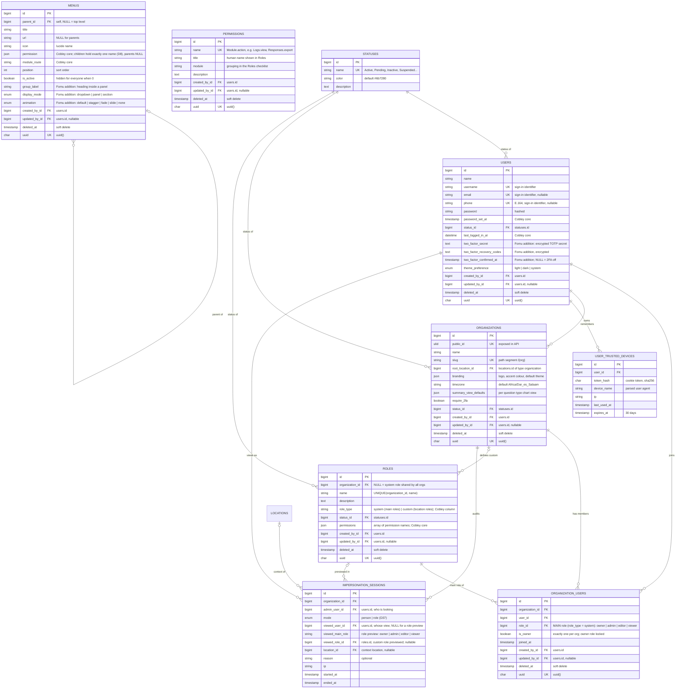
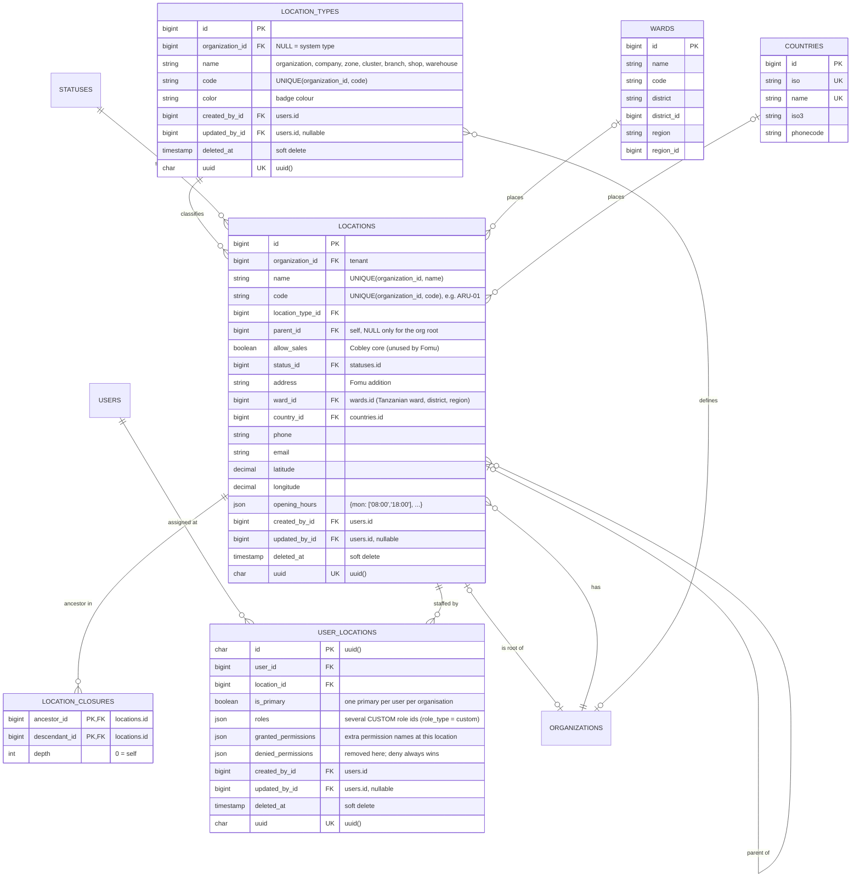
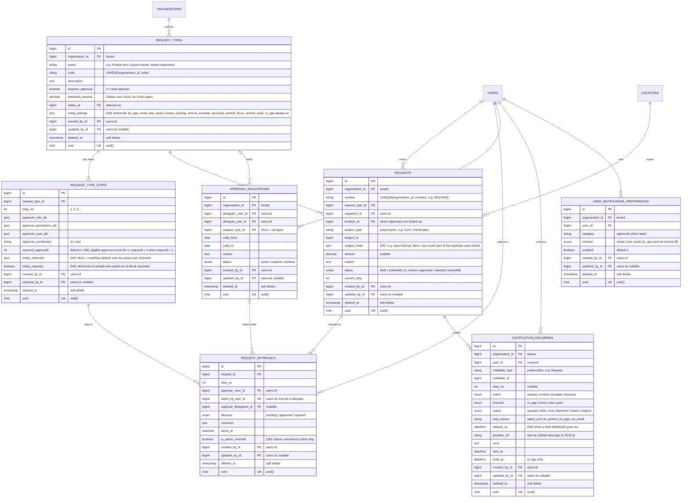

# Core ERD (platform)

> The tables every product inherits from the Cobley core, scoped by organization_id: identity and access, locations, approvals and notifications, plus the shared constraints, lifecycles and jobs. A product adds its own sections (02+) in its own ERD. Generated from the Fomu ERD; regenerate from architecture/erd_data.py when the core changes.

## 01. Platform core: identity & access

Shared kernel with Cobley (same table and column names) plus organization_id for tenancy. Users, statuses, organisations, roles with JSON permissions, menus. Builder URLs are path-based: /{org.slug}/forms.

- **STATUSES**: Cobley core. Master-data tables (users, organisations, locations, roles, request types) use status_id. Workflow states (forms, attempts, responses, requests) stay as enums.
- **USERS**: Cobley users + Fomu 2FA columns. Global: one user can belong to several organisations. Related Cobley auth tables kept as-is: otps, user_invitations, force_password_resets, personal_access_tokens, user_device_tokens.
- **USER_TRUSTED_DEVICES**: Fomu addition. Skips the 2FA step on a remembered device.
- **ORGANIZATIONS**: Fomu tenant. Every tenant-owned table carries organization_id behind a global scope. The org is also the root node of its location tree.
- **ORGANIZATION_USERS**: Membership + the user's one main role in this organisation. Location-specific custom roles live on user_locations. UNIQUE(organization_id, user_id).
- **ROLES**: Cobley roles + organization_id. System roles are assigned on organization_users; custom roles only on user_locations (never as a main role). Multi-valued index on permissions.
- **PERMISSIONS**: Cobley core catalogue, seeded by the app (Cobley's Module.action naming). Global, not editable by tenants.
- **MENUS**: Cobley menus + three display columns. Parent visible when ANY child is visible (OR).
- **IMPERSONATION_SESSIONS**: Fomu addition: audit for 'View as'. Read-only mode; every write is refused while a session is open.

## 01B. Platform core: locations

Cobley location tree (parent_id + closure table, typed by location_types) scoped per organisation. user_locations carries several custom roles per location plus JSON grants and denials. Reference lists: countries, wards.

- **LOCATION_TYPES**: Cobley core + organization_id so tenants can add their own types.
- **LOCATIONS**: Cobley location tree + organization_id and contact/geo columns. The manager is not stored here: it is whoever holds a Manager custom role in user_locations.
- **LOCATION_CLOSURES**: Cobley core. Every ancestor/descendant pair, so 'this location and everything under it' is one indexed query. Maintained on create/move.
- **USER_LOCATIONS**: Cobley core minus role_id (main roles stay on organization_users). Applies to the location and its descendants. UNIQUE(user_id, location_id). Multi-valued indexes on the three JSON arrays; changes written to the activity log.
- **COUNTRIES**: Cobley reference list (global).
- **WARDS**: Cobley reference list of Tanzanian wards (global).

## 01C. Platform core: approvals

Cobley approval workflow: request types with ordered steps (roles, permissions or users, OR/AND), requests per location, approval turns and delegations.

- **REQUEST_TYPES**: Cobley core + organization_id. Cannot be activated or saved while a step fails the D40 capacity rule.
- **REQUEST_TYPE_STEPS**: Cobley core. Approvers are resolved at the request's location (and its ancestors) using the effective-permission rule (D21).
- **REQUESTS**: Cobley core + organization_id. Request items (request_items) are kept for Cobley types and unused by Fomu.
- **REQUEST_APPROVALS**: Cobley core.
- **NOTIFICATION_DELIVERIES**: D43. One row per recipient x channel x event; Laravel notification channels write it; reminders are a scheduled job that reads open requests.
- **USER_NOTIFICATION_PREFERENCES**: D43. UNIQUE(organization_id, user_id, category, channel). Ignored when the step sets notify_required.
- **APPROVAL_DELEGATIONS**: Cobley core + organization_id.

## 08. Constraints & indexes

| Table | Constraint | Why |
|---|---|---|
| `form_responses` | `UNIQUE(form_id, dedupe_key)` | One response per email when one_response = 1. dedupe_key stays NULL otherwise, so the index does not block multi-response forms. |
| `form_attempts` | `UNIQUE(form_id, active_key)` | Only one in-progress attempt per respondent per form. active_key is cleared when the attempt ends. |
| `response_answers` | `INDEX(form_id, is_current, question_key, option_key)` | Powers the choice summaries with a single GROUP BY. |
| `response_answers` | `INDEX(form_id, is_current, question_key, value_int)` | Powers scale and rating averages and histograms. |
| `form_versions` | `UNIQUE(form_id, version_no)` | Versions are immutable; edits to a live form publish a new number. |
| `form_invitations` | `UNIQUE(form_id, email)` | One invitation per email per form; re-send updates the same row. |
| `forms` | `CHECK allow_edit = 0 WHEN timer_mode <> 'off'` | Enforced in a FormRequest and a model saving hook; MySQL CHECK as a backstop. |
| `user_locations` | `UNIQUE(user_id, location_id)` | One assignment row per user per location; roles and overrides live inside it. |
| `user_locations` | `INDEX((CAST(roles AS UNSIGNED ARRAY)))` | Multi-valued index for 'who holds role X here' (D20); same for granted/denied_permissions as CHAR(80) ARRAY. |
| `location_closures` | `PRIMARY(ancestor_id, descendant_id), INDEX(descendant_id, depth)` | Subtree and ancestor lookups in one indexed query (D21, D23). |
| `forms` | `INDEX(organization_id, location_id, status)` | Location-scoped form lists for managers. |
| `all tenant tables` | `INDEX(organization_id, ...)` | Leading organization_id on list indexes; global scope adds it to every builder query. |

## 09. Status lifecycles

- **FORMS.status**: draft → published → closed → archived — closed → published reopens. Publish creates a FORM_VERSIONS row each time.
- **FORM_ATTEMPTS.status**: in_progress → submitted | expired | voided | abandoned — expired = deadline passed (answers auto-submitted unless empty). voided = violation_policy void. Tab closed on a timed form: resume_policy resume keeps it in_progress with the clock running; auto_submit submits on heartbeat loss. abandoned = untimed, no heartbeat for 30 min.
- **FORM_ATTEMPT_SECTIONS.status**: open → completed | timed_out | skipped — skipped = conditional logic routed past it.
- **FORM_RESPONSES.status**: submitted → voided — Also inserted directly as voided when violation_policy = void. Owners and admins can void; voided rows leave the summary.
- **FORM_INVITATIONS.status**: pending → sent → opened → responded — revoked from any state before responded.
- **REQUESTS.status**: draft → submitted → in_review → approved | rejected — cancelled by the requester before a decision. current_step advances when a step's combinator and required_approvals are met.
- **FORM_EXPORTS.status**: queued → processing → ready | failed
- **WEBHOOK_DELIVERIES.status**: pending → success | failed — Retries stay pending until attempt_count hits the limit.

## 10. Async jobs

| Kind | Job | Does |
|---|---|---|
| Queue | `SubmitAttemptJob` | Finalises an attempt: validates path, writes revision + answers, flips is_current, bumps counters. |
| Queue | `DispatchResponseNotifications` | Instant emails to subscribers on ResponseSubmitted. |
| Queue | `DeliverWebhook` | Signed POST with exponential backoff. |
| Queue | `GenerateFormExport` | Builds XLSX/CSV via Laravel Excel on a private disk. |
| Queue | `SendFormInvitations` | Chunks invitation emails, sets sent_at. |
| Cron · every minute | `ExpireTimedAttempts` | Auto-submits or expires attempts past deadline_at + grace. |
| Cron · every minute | `HandleLostHeartbeats` | Timed + resume_policy auto_submit: submit after 60s without heartbeat. Untimed: mark abandoned after 30 min. |
| Cron · every minute | `CloseScheduledForms` | Closes forms past closes_at or at max_responses. |
| Cron · daily | `PruneOtps / SendDailyDigest` | Deletes consumed or expired OTPs; sends digest subscriptions. |

